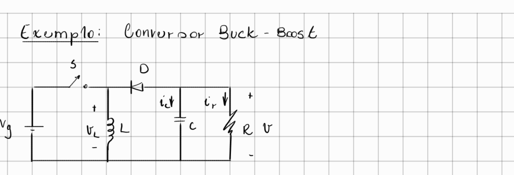
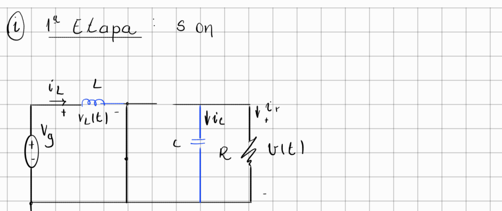
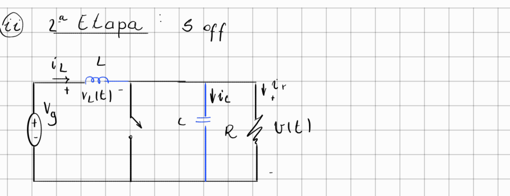
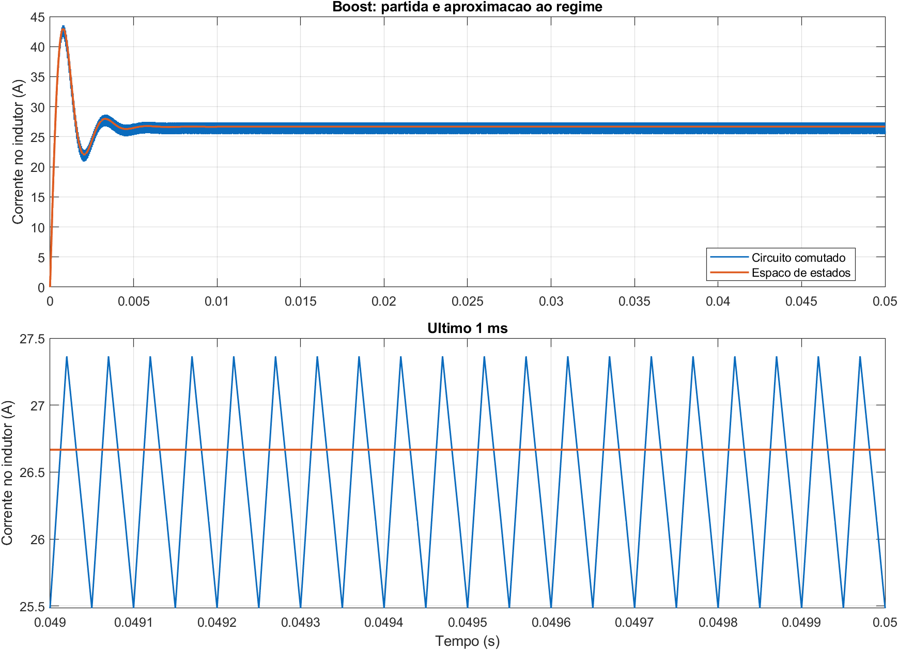
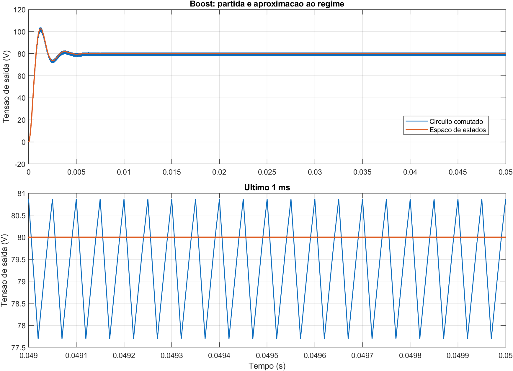
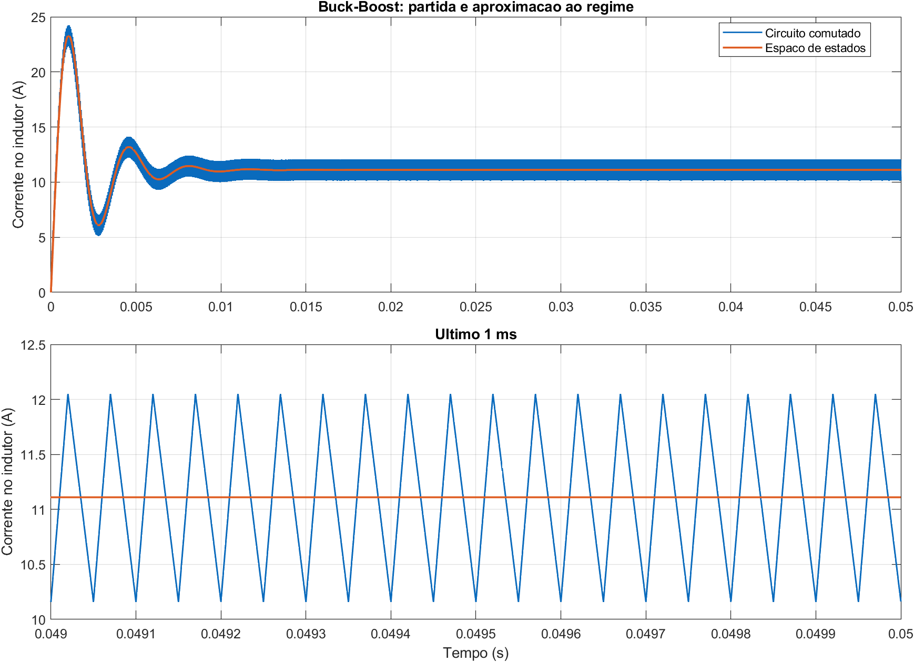
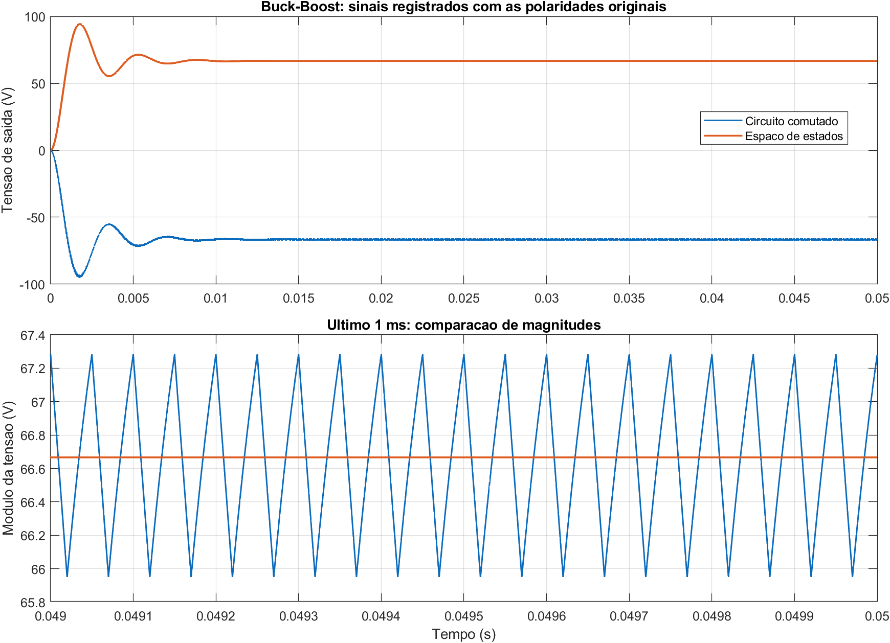

# Modelagem e controle de conversores

Este repositório reúne os modelos de simulação do **Boost** e do **Buck-Boost** com a sequência de modelagem que desenvolvi no meu caderno. A ideia é conseguir acompanhar o caminho sem pular etapas: primeiro vemos o circuito em cada posição da chave, depois escrevemos as equações de estado, fazemos a média por período de comutação e chegamos ao modelo de pequenos sinais.

As equações abaixo foram transcritas do PDF manuscrito para LaTeX. Mantive a notação, a ordem e os sinais como aparecem no documento. Os esquemas desenhados à mão também vieram de lá.

## O que está neste repositório

```text
.
├── README.md
├── docs
│   ├── figuras
│   │   ├── boost_etapa1_manuscrita.png
│   │   ├── boost_etapa2_manuscrita.png
│   │   └── buck_boost_topologia_manuscrita.png
│   └── fonte
│       └── Modelagem_e_controle_de_conversores.pdf
├── resultados
│   ├── boost
│   │   ├── boost_corrente.png
│   │   ├── boost_tensao.png
│   │   └── boost_dados.csv
│   └── buck-boost
│       ├── buck_boost_corrente.png
│       ├── buck_boost_tensao.png
│       └── buck_boost_dados.csv
└── simulacoes
    ├── boost
    │   ├── boost_conversor.slx
    │   └── boost_parametros.m
    ├── buck-boost
    │   ├── buck_boost_conversor.slx
    │   └── buck_boost_parametros.m
    └── cache
        └── BUCKboost_fim.slxc
```

## Buck-Boost

### O circuito desenhado à mão

O recorte abaixo preserva o esquema que desenhei no PDF.



### Primeira etapa: chave ligada

Na primeira etapa, as relações escalares e a representação em espaço de estados aparecem assim no caderno (página 23):

$$
\begin{aligned}
\dot{i}_L(t) &= \frac{1}{L}V_g \\
\dot{v}(t) &= -\frac{1}{RC}v(t)
\end{aligned}
$$

$$
\begin{bmatrix}
\dot{i}_L(t) \\
\dot{v}(t)
\end{bmatrix}
=
\begin{bmatrix}
0 & 0 \\
0 & -\frac{1}{RC}
\end{bmatrix}
\begin{bmatrix}
i_L(t) \\
v(t)
\end{bmatrix}
+
\begin{bmatrix}
\frac{1}{L} \\
0
\end{bmatrix}V_g
$$

$$
y(t)=x(t)=
\begin{bmatrix}
1 & 0 \\
0 & 1
\end{bmatrix}
\begin{bmatrix}
i_L(t) \\
v(t)
\end{bmatrix}
+
\begin{bmatrix}
0 \\
0
\end{bmatrix}V_g
$$

### Segunda etapa: chave desligada

A segunda etapa está na página 24. Transcrevi as relações escalares e, em seguida, a matriz exatamente como foram escritas:

$$
\begin{aligned}
v_L &= v \\
\dot{i}_L(t) &= \frac{1}{L}v \\
i_C &= -i_L-i_r \\
C\dot{v}(t) &= -i_L-\frac{v}{R}
\end{aligned}
$$

$$
\begin{bmatrix}
\dot{i}_L(t) \\
\dot{v}(t)
\end{bmatrix}
=
\begin{bmatrix}
0 & -\frac{1}{L} \\
\frac{1}{C} & -\frac{1}{RC}
\end{bmatrix}
\begin{bmatrix}
i_L(t) \\
v(t)
\end{bmatrix}
+
\begin{bmatrix}
0 \\
0
\end{bmatrix}V_g
$$

**Nota da transcrição:** no manuscrito, as relações escalares desta etapa e a matriz apresentam sinais de acoplamento diferentes. Mantive ambos como aparecem no PDF e deixei a divergência sinalizada, sem alterar a demonstração.

### Matrizes médias do Buck-Boost

Na página 34, as matrizes médias são formadas a partir das duas etapas:

$$
A_m=DA_1+D'A_2
=
\begin{bmatrix}
0 & -\frac{D'}{L} \\
\frac{D'}{C} & -\frac{D+D'}{RC}
\end{bmatrix}
=
\begin{bmatrix}
0 & -\frac{D'}{L} \\
\frac{D'}{C} & -\frac{1}{RC}
\end{bmatrix}
$$

$$
b_m=Db_1+D'b_2=
\begin{bmatrix}
\frac{D}{L} \\
0
\end{bmatrix}
$$

$$
C_m=DC_1+D'C_2=
\begin{bmatrix}
D+D' & 0 \\
0 & D+D'
\end{bmatrix}
=
\begin{bmatrix}
1 & 0 \\
0 & 1
\end{bmatrix}
$$

## Boost

### As duas etapas desenhadas à mão

Estes recortes mostram as etapas `S on` e `S off` do esquema Boost no PDF (páginas 25 e 26).

| Primeira etapa: chave ligada | Segunda etapa: chave desligada |
|---|---|
|  |  |

### Primeira etapa: chave ligada

No caderno, a corrente do indutor e a tensão no capacitor obedecem às relações abaixo (página 25):

$$
\begin{aligned}
V_g-L\frac{di_L(t)}{dt} &= 0 \\
\dot{i}_L(t) &= \frac{1}{L}V_g \\
i_C+i_r &= C\frac{dv_C(t)}{dt}+\frac{v_C(t)}{R}=0 \\
\dot{v}_C(t) &= -\frac{1}{RC}v_C(t)
\end{aligned}
$$

$$
\begin{bmatrix}
\dot{i}_L(t) \\
\dot{v}_C(t)
\end{bmatrix}
=
\begin{bmatrix}
0 & 0 \\
0 & -\frac{1}{RC}
\end{bmatrix}
\begin{bmatrix}
i_L(t) \\
v_C(t)
\end{bmatrix}
+
\begin{bmatrix}
\frac{1}{L} \\
0
\end{bmatrix}V_g
$$

### Segunda etapa: chave desligada

Com a chave desligada, o indutor também entrega energia à saída (página 26):

$$
\begin{aligned}
V_g-L\frac{di_L(t)}{dt}-v_C(t) &= 0 \\
\dot{i}_L(t) &= -\frac{1}{L}v_C(t)+\frac{1}{L}V_g \\
i_L &= i_C+i_r=C\frac{dv_C(t)}{dt}+\frac{v_C(t)}{R} \\
\dot{v}_C(t) &= \frac{1}{C}i_L(t)-\frac{1}{RC}v_C(t)
\end{aligned}
$$

$$
\begin{bmatrix}
\dot{i}_L(t) \\
\dot{v}_C(t)
\end{bmatrix}
=
\begin{bmatrix}
0 & -\frac{1}{L} \\
\frac{1}{C} & -\frac{1}{RC}
\end{bmatrix}
\begin{bmatrix}
i_L(t) \\
v_C(t)
\end{bmatrix}
+
\begin{bmatrix}
\frac{1}{L} \\
0
\end{bmatrix}V_g
$$

### Modelo médio do Boost

A página 37 aplica a média das matrizes das duas etapas:

$$
A_m=DA_1+D'A_2
=
\begin{bmatrix}
0 & -\frac{D'}{L} \\
\frac{D'}{C} & -\frac{D+D'}{RC}
\end{bmatrix}
=
\begin{bmatrix}
0 & -\frac{D'}{L} \\
\frac{D'}{C} & -\frac{1}{RC}
\end{bmatrix}
$$

$$
B_m=DB_1+D'B_2=
\begin{bmatrix}
\frac{1}{L} \\
0
\end{bmatrix}
$$

## Da média ao modelo de pequenos sinais

No PDF, a média em um período de comutação é escrita desta forma (página 30):

$$
\frac{d\langle x(t)\rangle_{T_s}}{dt}
=
\left[d(t)A_1+d'(t)A_2\right]\langle x(t)\rangle_{T_s}
+
\left[d(t)b_1+d'(t)b_2\right]\langle u(t)\rangle_{T_s}
$$

$$
\langle y(t)\rangle_{T_s}
=
\left[d(t)C_1+d'(t)C_2\right]\langle x(t)\rangle_{T_s}
+
\left[d(t)E_1+d'(t)E_2\right]\langle u(t)\rangle_{T_s}
$$

Depois, o ponto de operação é separado das pequenas perturbações (páginas 22 e 31):

$$
\begin{aligned}
\langle x(t)\rangle_{T_s} &= X+\hat{x}(t) \\
\langle u(t)\rangle_{T_s} &= U+\hat{u}(t) \\
\langle y(t)\rangle_{T_s} &= Y+\hat{y}(t) \\
d(t) &= D+\hat{d}(t)
\end{aligned}
$$

Com a aproximação de pequenas perturbações do caderno, o modelo linearizado fica (página 33):

$$
\begin{aligned}
\frac{d\hat{x}(t)}{dt}
&=A\hat{x}(t)+b\hat{u}(t)
+\left\{(A_1-A_2)X+(b_1-b_2)U\right\}\hat{d}(t) \\
\hat{y}(t)
&=C\hat{x}(t)+E\hat{u}(t)
+\left\{(C_1-C_2)X+(E_1-E_2)U\right\}\hat{d}(t)
\end{aligned}
$$

A razão cíclica aparece como uma entrada do modelo de pequenos sinais. É isso que permite usar a representação linearizada para estudar a resposta do conversor perto do ponto de operação.

## Os arquivos de simulação

| Conversor | Arquivos e parâmetros encontrados |
|---|---|
| Boost | `boost_conversor.slx` e `boost_parametros.m`; indutor de 500 µH, capacitor de 100 µF, carga de 5 Ω, fonte de 48 V, razão cíclica de 40% e comutação de 20 kHz. O bloco de espaço de estados usa as matrizes `Ab`, `Bb`, `Cb` e `Eb`, definidas pelo script. |
| Buck-Boost | `buck_boost_conversor.slx` e `buck_boost_parametros.m`; indutor de 1059 µH, capacitor de 100 µF, carga de 10 Ω, fonte de 100 V, razão cíclica de 40% e comutação de 20 kHz. O script define `Ap`, `Bp`, `Cp` e `Ep` para o bloco de espaço de estados a partir das matrizes do manuscrito. |

O arquivo `BUCKboost_fim.slxc` foi mantido em `simulacoes/cache/` porque veio junto com os arquivos. Ele é um cache do modelo chamado `BUCKboost_fim` no MATLAB R2024b; como o modelo incluído se chama `buck_boost_conversor.slx`, o cache não deve ser tratado como parte necessária para abrir ou executar esse `.slx`.

## Modelagem e simulação lado a lado

Executei os dois modelos por 0,05 s no MATLAB R2024b com Simulink e Simscape Electrical. Nos osciloscópios `I` e `V`, o primeiro sinal vem dos medidores do circuito comutado e o segundo vem do bloco `Modelo transitório`, em espaço de estados. Os gráficos mostram a partida inteira e, abaixo, o último milissegundo. Os CSVs guardam os dados registrados, inclusive a polaridade original da tensão.

Para comparar valores próximos do regime, calculei a média temporal dos sinais no último 1 ms. A diferença abaixo é relativa ao valor do bloco em espaço de estados.

| Conversor | Grandeza | Circuito comutado | Espaço de estados | Diferença |
|---|---:|---:|---:|---:|
| Boost | Corrente no indutor | 26,430 A | 26,667 A | −0,89% |
| Boost | Tensão de saída | 79,306 V | 80,000 V | −0,87% |
| Buck-Boost | Corrente no indutor | 11,106 A | 11,111 A | −0,04% |
| Buck-Boost | Módulo da tensão de saída | 66,646 V | 66,667 V | −0,03% |

### Boost





### Buck-Boost





No Buck-Boost, o medidor do circuito registra aproximadamente −66,646 V, enquanto o bloco em espaço de estados fornece +66,667 V. Por isso a tabela compara os módulos. Essa concordância de magnitude não resolve a diferença de sinal; a convenção de polaridade do modelo e a divergência entre as relações escalares e a matriz da página 24 precisam ser consideradas ao interpretar a representação em espaço de estados. Mantive os sinais que saíram de cada simulação.

## Como abrir

1. Abra o MATLAB e adicione a pasta do conversor desejado ao caminho.
2. Para o Boost, execute `boost_parametros.m` antes de abrir `boost_conversor.slx`; assim o bloco de espaço de estados encontra as matrizes esperadas.
3. Abra o `.slx` correspondente no Simulink. Os modelos usam blocos da biblioteca `sps_lib` e o bloco `powergui`.
4. Para o Buck-Boost, execute `buck_boost_parametros.m` antes de abrir `buck_boost_conversor.slx`; o script define `Ap`, `Bp`, `Cp` e `Ep` segundo as matrizes escritas no PDF.

## Referência bibliográfica

Erickson, Robert W.; Maksimović, Dragan. *Fundamentals of Power Electronics*. 3ª ed. Springer, Cham, 2020. [Página da editora](https://link.springer.com/book/10.1007/978-3-030-43881-4). [DOI](https://doi.org/10.1007/978-3-030-43881-4).
